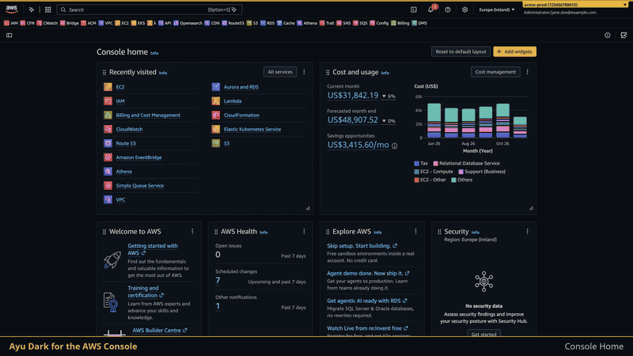
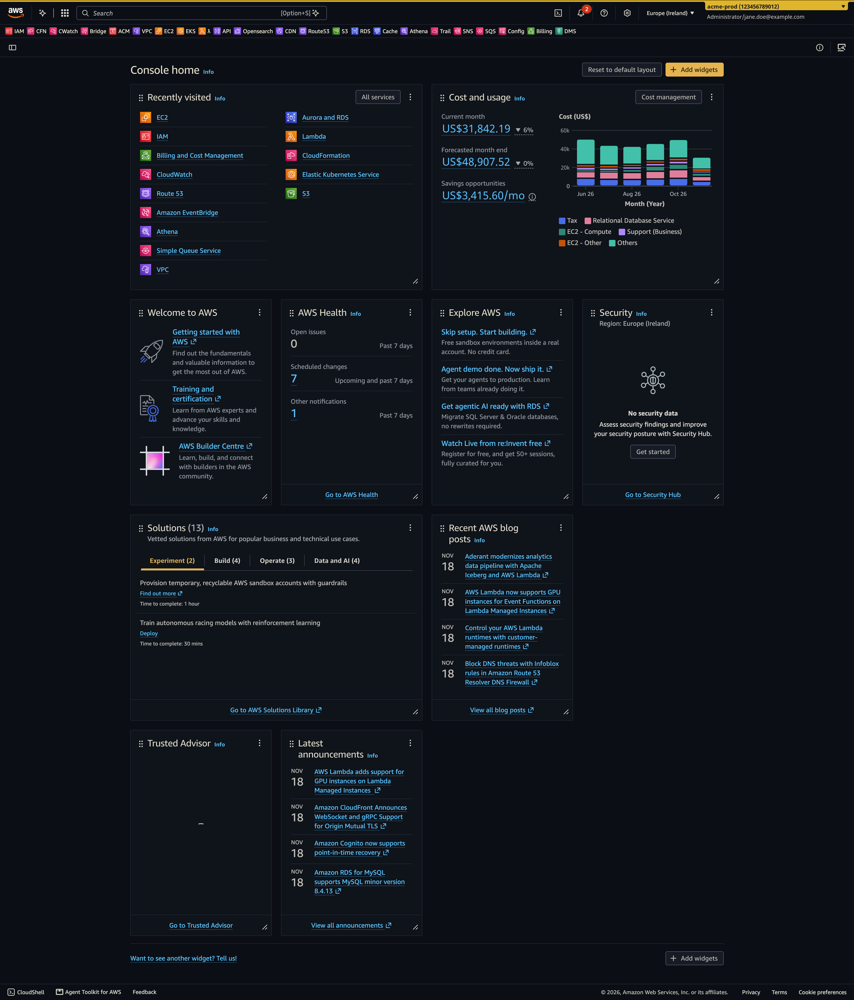
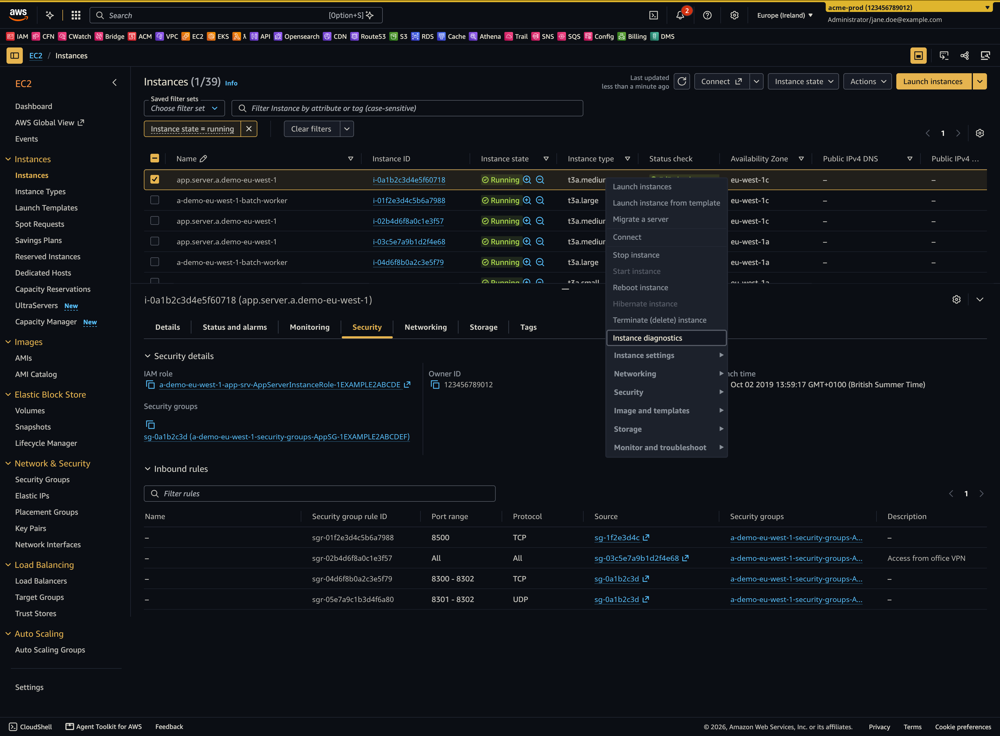
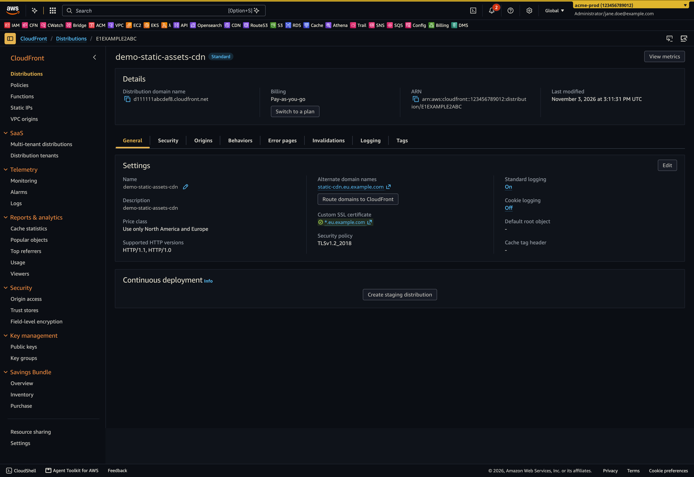
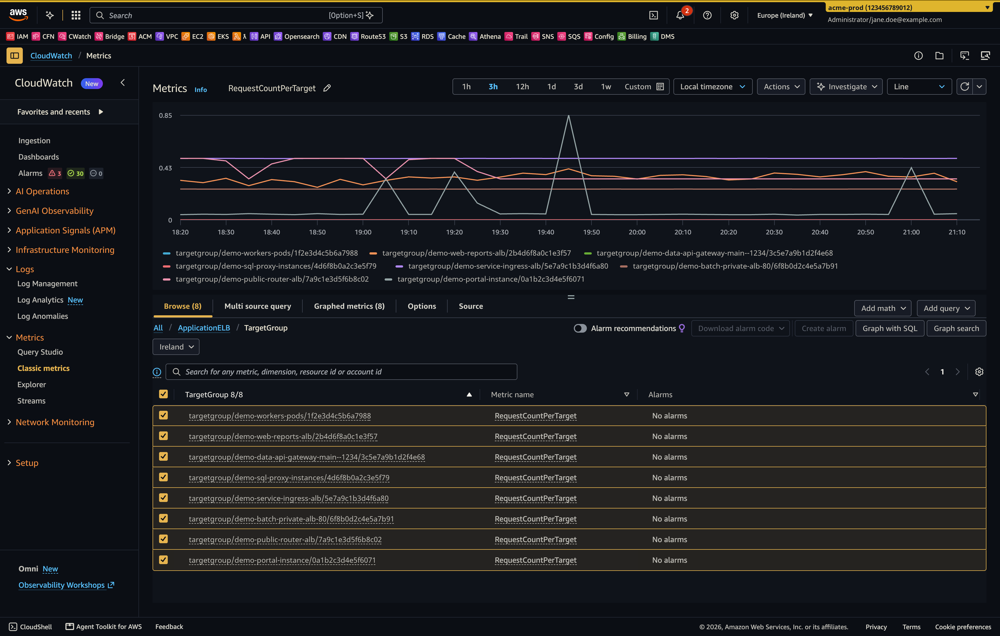
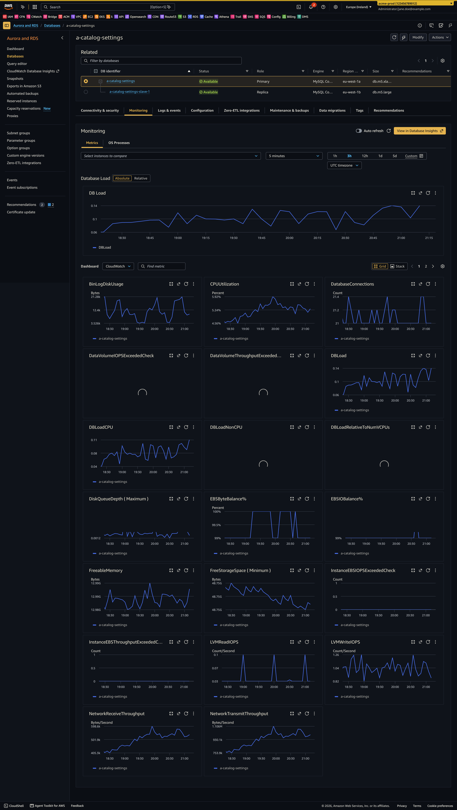

# AWS Console: Ayu Dark

User styles that restore colour and the classic typeface to the AWS Management Console.

The console's "one theme" dark mode is almost entirely monochrome. These styles override its Cloudscape design tokens with the [Ayu Dark](https://github.com/ayu-theme/ayu-colors) palette, and optionally swap the new Ember Modern typeface back to the previous console fonts.

The same preview is available as a [full resolution video](previews/aws-console-ayu-dark-preview.mp4).

## Screenshots

All account details, resource names and figures in these screenshots are placeholders.

| Console Home | EC2 |
|---|---|
|  |  |

| CloudFront | CloudWatch | Aurora and RDS |
|---|---|---|
|  |  |  |

## What is included

| Style | What it does | Applies in |
|---|---|---|
| Ayu Dark theme | Recolours the dark console with the Ayu Dark palette | Dark mode with the one theme only. Light mode is untouched. |
| Classic font | Reverts text to Amazon Ember and code to Monaco, Menlo or Consolas | Light and dark mode |

The two styles are independent. Install either one, or both.

Each style ships in two forms with identical rules:

| Folder | Format | Use it with |
|---|---|---|
| [`userstyles/`](userstyles/) | Wrapped in `@-moz-document domain("console.aws.amazon.com")` | Stylus and other user style managers that read the domain from the file |
| [`stylesheets/`](stylesheets/) | Plain CSS with no wrapper | Extensions where you set the target site yourself, or any other way of injecting CSS |

## Install

### Stylus

1. Install [Stylus](https://github.com/openstyles/stylus) for your browser.
2. Create a new style and import the contents of a file from [`userstyles/`](userstyles/):
   - [`aws-console.ayu-dark-theme.css`](userstyles/aws-console.ayu-dark-theme.css)
   - [`aws-console.classic-font.css`](userstyles/aws-console.classic-font.css)
3. Keep "Apply to iframes" enabled. Most service pages render inside an iframe, and the style will not reach them otherwise.
4. Switch the console to dark mode under Settings, then Visual mode.

### Other extensions

Use the files in [`stylesheets/`](stylesheets/) and scope them to `console.aws.amazon.com` and its subdomains, including iframes.

## Palette

| Role | Colour |
|---|---|
| Background | `#0b0e14` |
| Panel | `#0f131a` |
| Foreground | `#bfbdb6` |
| Accent | `#e6b450` |
| Blue | `#59c2ff` |
| Green | `#aad94c` |
| Red | `#f07178` |
| Yellow | `#ffb454` |
| Orange | `#ff8f40` |
| Purple | `#d2a6ff` |
| Teal | `#95e6cb` |

## Known limitations

Cloudscape token names carry a hash suffix that changes per build, such as `--color-neutral-50-bsrnvs`. Each AWS service ships its own Cloudscape build, so the styles list every hash that was known when they were generated.

A service page whose build is not covered stays monochrome, or keeps the new font, until its hashes are added. AWS can also change these hashes at any time, so expect occasional gaps after console updates. If you find a page that is not themed, please open an issue naming the service.

## Disclaimer

This is an unofficial project. It is not affiliated with, endorsed by or supported by Amazon Web Services.

## Licence

Released under the [MIT Licence](LICENSE).
